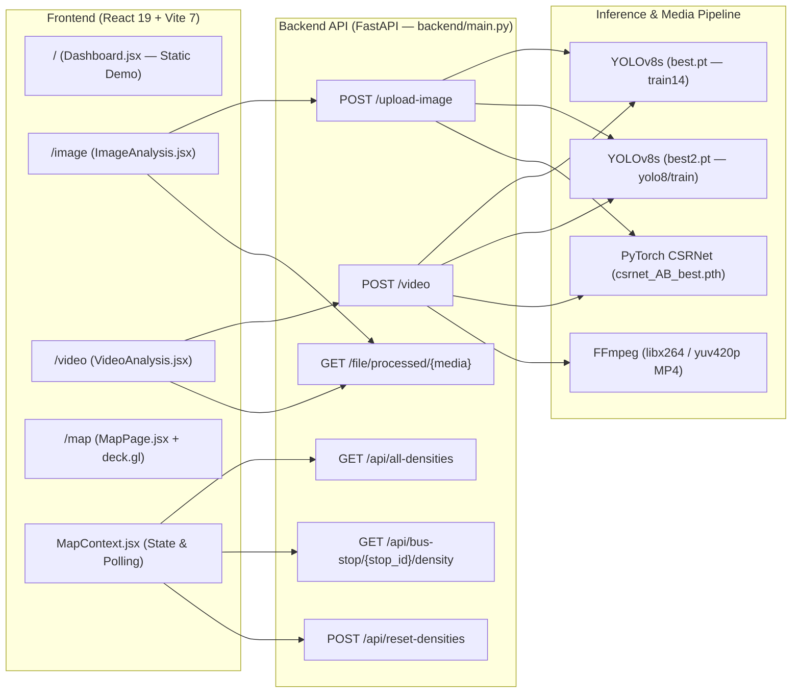
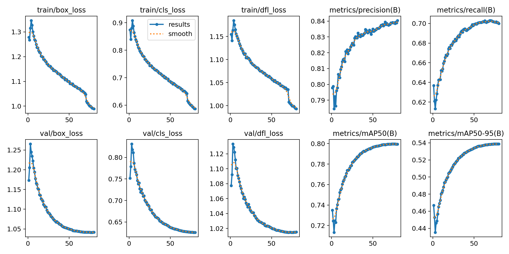
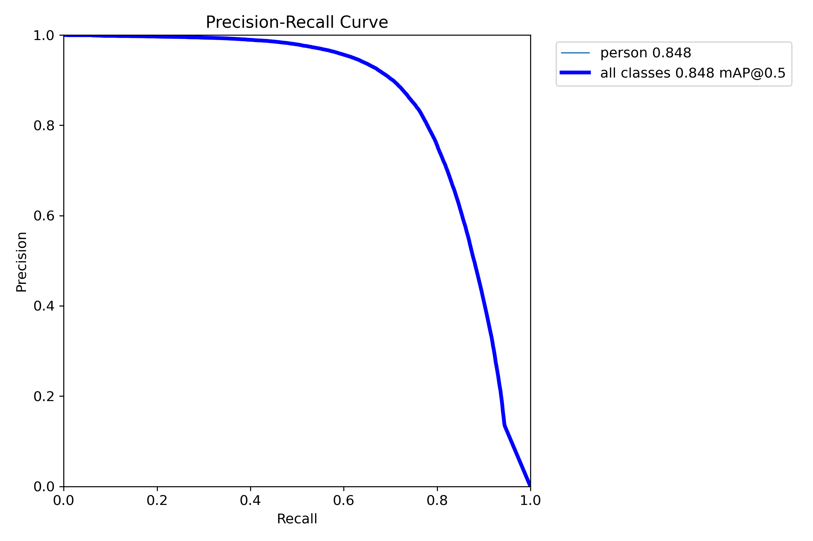
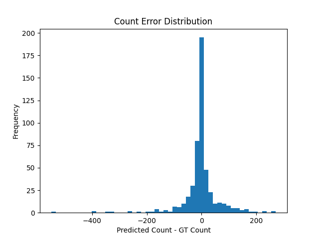

# Hybrid Crowd Counting & Public Transit Density Analysis (YOLOv8 + CSRNet)


A full-stack computer engineering graduation project (*Bitirme Projesi*) designed for automated crowd counting, density estimation, and geospatial transit-stop visualization across 15 major Istanbul public transport hubs.

To handle the wide variation in crowd density observed at transit stations, the platform integrates two complementary computer vision paradigms inside a unified **FastAPI** backend and **React + Vite + Tailwind CSS + Chart.js + Google Maps / deck.gl** web application:
- **Sparse-to-Moderate Crowds (`YOLOv8s`):** Bounding-box person detection (`best` and `best2`) for scenes where individual pedestrians are distinguishable.
- **Congested / High-Density Crowds (`CSRNet`):** Dilated convolutional density-map regression (`csrnet_ab`) with $384 \times 384$ overlapping Gaussian patch inference for heavily occluded scenes where bounding-box detectors saturate.

> **Language / Dil:** [English (`README.md`)](README.md) | [Türkçe (`docs/README.tr.md`)](docs/README.tr.md)

---

## System Architecture



---

## Technology Stack

| Layer | Technologies |
|---|---|
| **Backend & API** | Python 3.12.7, FastAPI 0.121.3, Uvicorn 0.38.0, python-multipart |
| **Deep Learning & Vision** | PyTorch 2.5.1 + Torchvision 0.20.1 (CUDA 12.1), Ultralytics YOLOv8 (`8.3.237`), OpenCV (`4.12.0.88`), Pillow, NumPy, SciPy, h5py |
| **Media Transcoding** | FFmpeg (`libx264`, `yuv420p`, `-movflags +faststart`) |
| **Frontend UI** | React 19.2, React Router 7, Vite 7.2, Tailwind CSS 3.4, Lucide Icons |
| **Charts & Geospatial** | Chart.js 4.5 + `react-chartjs-2`, Google Maps JavaScript API (`AdvancedMarkerElement`, `InfoWindow`), `deck.gl` (`@deck.gl/GoogleMapsOverlay`, `HeatmapLayer`) |

---

## Repository Structure

```text
hybrid-crowd-counting/
├── backend/                        # Production FastAPI application
│   ├── main.py                     # API entry point (YOLOv8 + CSRNet inference, stop densities)
│   ├── models/
│   │   ├── csrnet.py               # PyTorch CSRNet (VGG16 front-end + dilated conv back-end)
│   │   └── __init__.py             # (Local weights best.pt, best2.pt, csrnet_AB_best.pth go here; git-ignored)
│   ├── tests/
│   │   └── test_security_and_api.py# Security regression, clean-clone 503 & inference integration tests
│   ├── legacy/                     # Archived early Node.js/Express prototype & unused helpers
│   ├── uploads/                    # Runtime temporary upload directory (git-ignored)
│   ├── processed/                  # Runtime annotated image/video output directory (git-ignored)
│   ├── requirements.txt            # Direct pinned backend dependencies
│   ├── requirements-lock.txt       # Full exact environment snapshot (Python 3.12.7 + CUDA 12.1)
│   └── .env.example                # Backend environment variable template
├── frontend/                       # React 19 + Vite 7 + Tailwind CSS + Chart.js + Google Maps UI
│   ├── src/
│   │   ├── config.js               # Environment-driven API base URL & Google Maps configuration
│   │   ├── context/MapContext.jsx  # Stop marker & deck.gl heatmap state synchronization
│   │   ├── data/stops.js           # Coordinates & metadata for 15 Istanbul transit stops
│   │   ├── components/             # Navbar (dark mode) & Sidebar navigation
│   │   └── pages/                  # Dashboard, ImageAnalysis, VideoAnalysis, MapPage
│   ├── public/stops/               # Local transit-stop popup photos (git-ignored; see public/stops/README.md)
│   ├── package.json
│   ├── package-lock.json
│   └── .env.example                # Frontend environment variable template
├── research/                       # Machine learning training, evaluation & preprocessing scripts
│   ├── training/
│   │   ├── csrnet_shanghaitech/    # Operational PyTorch CSRNet (Part A + Part B joint training)
│   │   ├── csrnet_ucf_qnrf/        # CSRNet UCF-QNRF experiments
│   │   ├── csrnet_v1/              # Early CSRNet training prototype
│   │   └── yolo/                   # YOLOv8 & YOLOv9 training scripts
│   ├── evaluation/
│   │   ├── csrnet_shanghaitech/    # Patch-based evaluation & ShanghaiTech A+B metrics
│   │   ├── csrnet_ucf_qnrf/        # UCF-QNRF evaluation & patch inference scripts
│   │   ├── csrnet_v1/              # Early CSRNet evaluation scripts
│   │   └── yolo/                   # YOLO test scripts & sanitized training run logs/curves
│   ├── preprocessing/              # Dataset converters (CrowdHuman, MOT20, ShanghaiTech, UCF-QNRF)
│   ├── configs/                    # Dataset YAML definitions & dataset attribution records
│   ├── legacy/                     # Early Streamlit/RandomForest prototype & webcam scripts
│   └── requirements.txt            # Research environment dependencies
├── examples/                       # Place rights-cleared sample inputs here (see examples/README.md)
├── docs/                           # Detailed technical documentation
│   ├── README.tr.md                # Turkish project documentation
│   ├── ARCHITECTURE.md             # System architecture & API contract specification
│   ├── MODELS_AND_EXPERIMENTS.md   # Verified model provenance, metrics & reproducibility notes
│   └── SECURITY_AND_LICENSING.md   # Security hardening, Google Maps key guide & licensing review
├── LICENSE                         # GNU Affero General Public License v3.0 (original project code)
├── THIRD_PARTY_NOTICES.md          # Third-party attributions, dataset credits & academic citations
├── .env.example                    # Root environment variable reference
└── .gitignore                      # Excludes weights, datasets, unapproved media, venvs & secrets
```

---

## Models, Architectures & Verified Evaluation Results

> [!NOTE]
> **Methodological Note on Evaluation Metrics:**
> Object detection models (**YOLOv8**) and density-regression models (**CSRNet**) optimize different objectives on different datasets and are evaluated with distinct metrics:
> - **YOLOv8s** is evaluated using bounding-box detection metrics (**Precision**, **Recall**, **mAP@50**, **mAP@50-95**) on person-detection validation splits.
> - **CSRNet** is evaluated using whole-image crowd-count regression errors (**MAE** — Mean Absolute Error, and **RMSE** — Root Mean Squared Error) across congested crowd scenes.
>
> These metrics measure different tasks on different benchmarks and **must not** be interpreted as directly comparable scores on a single scale.

### 1. YOLOv8s Person Detection Models (`best` and `best2`)

Both runtime YOLO options use the `YOLOv8s` architecture (`11.2M` parameters, $640 \times 640$ input resolution) fine-tuned for single-class (`cls == 0`, `person`) detection:

| Runtime Key | Source Training Run | Dataset & Split | Epochs | Precision | Recall | mAP@50 | mAP@50-95 |
|---|---|---|---:|---:|---:|---:|---:|
| **`best`** (`best.pt`) | [`yolov8s_reid_train14__APP_best`](research/evaluation/yolo/runs/yolov8s_reid_train14__APP_best/results.csv) | `reid.v1i.yolov8` (held-out `valid`) | 50 | `0.8180` | `0.6929` | **`0.7796`** | `0.4832` |
| **`best2`** (`best2.pt`) | [`yolov8s_yolo8_train__APP_best2`](research/evaluation/yolo/runs/yolov8s_yolo8_train__APP_best2/results.csv) | `yolo8/data.yaml` (held-out `valid`) | 80 | `0.8588` | `0.8077` | **`0.8736`** | `0.6251` |

#### Tracked YOLOv8s Training & Validation Curves
| `best2` (`yolo8/train`) — 80-Epoch Training Summary | `best` (`train14`) — Precision-Recall Curve |
|---|---|
|  |  |

---

### 2. PyTorch CSRNet Density Regression Model (`csrnet_ab`)

- **Architecture ([`backend/models/csrnet.py`](backend/models/csrnet.py)):**
  - **Front-End:** First 23 layers of ImageNet-pretrained `VGG16` (`features[:23]`, up to `conv4_3` with 3 max-pooling layers -> output stride $8$).
  - **Back-End:** 6 dilated convolutional layers (`dilation=2`, `padding=2`, channels $512 \to 512 \to 512 \to 256 \to 128 \to 64$ with `ReLU`) followed by a $1 \times 1$ output convolution producing a single-channel density map.
- **Training Pipeline ([`research/training/csrnet_shanghaitech/train.py`](research/training/csrnet_shanghaitech/train.py)):**
  - Trained jointly on **ShanghaiTech Part A + Part B** (`ConcatDataset`) for `120` epochs (`batch=8`, `lr=5e-6`, `crop=384`) combining pixel-wise MSE loss, scene-aware relative count loss (`A/B` density weighting), and background suppression loss.
- **Patch Inference & Gaussian Blending (`backend/main.py`):**
  - At runtime, full-resolution images and video frames are evaluated using overlapping $384 \times 384$ patches ($\text{stride} = 192$), weighted by a 2D Gaussian window ($\sigma = 0.5$) to eliminate patch boundary seams, and rendered as an alpha-blended OpenCV `COLORMAP_JET` heatmap.

| Runtime Key | Evaluation Benchmark | MAE | RMSE | Under-Count Ratio | Over-Count Ratio | Within $\pm 10\%$ Error |
|---|---|---:|---:|---:|---:|---:|
| **`csrnet_ab`** (`csrnet_AB_best.pth`) | ShanghaiTech Part A + Part B (Combined Test Set, [`summary.txt`](research/evaluation/csrnet_shanghaitech/results/summary.txt)) | **`35.84`** | **`69.92`** | `0.540` | `0.460` | **`51.4%`** (`0.514`) |

#### Tracked CSRNet Count Error Distribution


See [`docs/MODELS_AND_EXPERIMENTS.md`](docs/MODELS_AND_EXPERIMENTS.md) for the complete experiment inventory across all YOLO and CSRNet runs.

---

## Application Features (Verified from Implementation)

1. **Multi-Model Image Crowd Analysis (`/image` -> `POST /upload-image`):**
   - Select one of 15 Istanbul transit hubs and analyze an uploaded image with `best` (YOLOv8s), `best2` (YOLOv8s), or `csrnet_ab` (CSRNet).
   - Displays the estimated person count, renders the annotated bounding-box or JET density-heatmap image from `/file/processed/annotated_<uuid>.jpg`, and updates the selected transit stop's live marker on the map.
2. **Video Crowd Analysis & Time-Series Synchronization (`/video` -> `POST /video`):**
   - Processes uploaded videos frame-by-frame with YOLOv8s (or every 5th frame with CSRNet), writes annotated frames, and transcodes the output to browser-compatible H.264 MP4 (`yuv420p`, `+faststart`) via FFmpeg.
   - Renders an interactive **Chart.js** time-series line chart synchronized with the HTML5 video player's current playback timestamp (`onTimeUpdate`), alongside a frame-by-frame table and overall average count.
3. **Interactive Geospatial Transit Map (`/map`):**
   - Visualizes 15 Istanbul transit hubs (Zincirlikuyu, Mecidiyeköy, Söğütlüçeşme, Avcılar, Taksim, Levent, Yenikapı, Üsküdar, Beşiktaş, Kadıköy Rıhtım, Eminönü, Karaköy, Esenler Otogar, Cevahir AVM, İstiklal Caddesi) using Google Maps `AdvancedMarkerElement` and a toggleable **deck.gl `HeatmapLayer`**.
   - Polls `GET /api/all-densities` every 10 seconds and queries `GET /api/bus-stop/{stop_id}/density` when a stop marker is clicked.
4. **Dashboard Overview (`/`, Static Demonstration View):**
   - Displays a sample Chart.js bar chart layout (`frontend/src/pages/Dashboard.jsx`). Note: this view currently renders static demonstration numbers rather than live backend aggregations (see [Known Limitations](#known-limitations)).

---

## Quick Start & Reproducible Setup

### Prerequisites

| Component | Verified Version | Notes |
|---|---|---|
| **OS** | Windows 10/11 or Linux | Developed and tested on Windows with NVIDIA RTX 3050 Ti Laptop GPU |
| **Python** | **3.12.7** (compatible with 3.10–3.12) | Original backend environment built with Python 3.12.7 |
| **PyTorch / CUDA** | **torch 2.5.1 + torchvision 0.20.1 (CUDA 12.1)** | Automatic CPU fallback (`torch.cuda.is_available()`) is built in |
| **Ultralytics** | **8.3.237** | Used for loading YOLOv8s checkpoints |
| **FFmpeg** | Any build with `libx264` | Must be on system `PATH` or configured via `FFMPEG_PATH` |
| **Node.js / npm** | **Node.js 20+ / 24.x**, **npm 10+ / 11.x** | Verified with Node v24.11.1, npm 11.6.2 |

### 1. Local Runtime Model Checkpoints (Option C — Local-Only)

Model checkpoints (`~105 MB` total) are excluded from the public Git repository via [`.gitignore`](.gitignore) due to file size and upstream dataset licensing boundaries (see [`THIRD_PARTY_NOTICES.md`](THIRD_PARTY_NOTICES.md)). To run live inference locally, place the three checkpoint files in `backend/models/` (or reproduce them using the scripts in [`research/training/`](research/training/)):

| Model Key | Expected Path | Size | MD5 Prefix | Architecture & Source Run |
|---|---|---:|---|---|
| `best` | `backend/models/best.pt` | `22.5 MB` | `A3A32B3DF5` | YOLOv8s (`runs/detect/train14/weights/best.pt`) |
| `best2` | `backend/models/best2.pt` | `22.5 MB` | `CB238468C7` | YOLOv8s (`yolo8/runs/detect/train/weights/best2.pt`) |
| `csrnet_ab` | `backend/models/csrnet_AB_best.pth` | `65.1 MB` | `F34C96BDCE` | PyTorch CSRNet (`ShanghaiTech/weights/csrnet_AB_best.pth`) |

> **Clean-Clone Behavior (Without Local Assets):**
> - If a fresh clone is started before placing model checkpoints in `backend/models/`, the FastAPI server starts normally (`GET /api/all-densities` and `GET /api/bus-stop/{id}/density` work immediately), and inference endpoints (`POST /upload-image`, `POST /video`) return a clean `503 Service Unavailable` JSON error instructing you to place the required checkpoint in `backend/models/`.
> - Local transit-stop reference photographs in `frontend/public/stops/*.jpg` are also excluded from Git due to unconfirmed redistribution rights. On a clean clone, map marker popups automatically hide the missing image element (via a DOM `error` event listener) while displaying the stop title, density badge, and live person count cleanly.

### 2. Backend Setup (FastAPI)

```powershell
cd backend
python -m venv .venv
.\.venv\Scripts\activate

# (Recommended for NVIDIA GPUs) Install CUDA 12.1 PyTorch first:
pip install torch==2.5.1 torchvision==0.20.1 --index-url https://download.pytorch.org/whl/cu121

# Install remaining backend dependencies:
pip install -r requirements.txt

# Run automated security and API tests:
python -B tests/test_security_and_api.py

# Start the FastAPI server on port 8000:
uvicorn main:app --host 127.0.0.1 --port 8000
```

- **API Documentation:** Interactive Swagger UI is served at `http://127.0.0.1:8000/docs` when the backend is running, and the full endpoint contract is documented in [`docs/ARCHITECTURE.md`](docs/ARCHITECTURE.md).

### 3. Frontend Setup (React + Vite)

```powershell
cd frontend
cp .env.example .env
# Edit .env and set VITE_GOOGLE_MAPS_API_KEY to your HTTP-referrer-restricted browser key

npm ci
npm run dev
```

Open `http://localhost:5173` in your browser.

---

## Security Notes

- **Frontend Environment Variables Are Public:** Variables prefixed with `VITE_` (including `VITE_GOOGLE_MAPS_API_KEY`) are statically embedded into the client-side browser bundle by Vite. Using `.env` keeps keys out of Git commits, **not** out of the browser. You **must** restrict your Google Maps key in Google Cloud Console by **HTTP referrers** and restrict its API scope exclusively to **Maps JavaScript API**. See [`docs/SECURITY_AND_LICENSING.md`](docs/SECURITY_AND_LICENSING.md).
- **Safe Media Serving:** `GET /file/{path}` strictly serves files resolved inside `backend/processed/` with allowed media extensions (`.jpg`, `.jpeg`, `.png`, `.mp4`), rejecting path traversal (`..`), absolute paths, or access to `uploads/`, `models/`, or source code with HTTP `403`.
- **Restricted CORS:** Wildcard CORS (`*`) has been replaced with an explicit allowlist configured via `CORS_ALLOWED_ORIGINS`.

---

## Known Limitations

1. **In-Memory Stop Densities:** Transit stop counts (`STOP_DENSITY`) are stored in process memory and reset when the backend restarts or when `POST /api/reset-densities` is called.
2. **Static Dashboard Chart:** [`frontend/src/pages/Dashboard.jsx`](frontend/src/pages/Dashboard.jsx) currently displays static demonstration bar-chart values rather than live database aggregations.
3. **CSRNet Video Frame Stride:** To keep CPU/GPU latency tractable, [`backend/main.py`](backend/main.py) evaluates every 5th frame (`CSRNET_VIDEO_FRAME_SKIP = 5`) during CSRNet video analysis and writes only evaluated frames to the output video.
4. **Auxiliary Research Run Caveats:** While `train14` (`best.pt`), `yolo8/train` (`best2.pt`), and `ShanghaiTech` CSRNet have valid train/val splits, two auxiliary research runs (`train15` and `train16`) evaluated on training images (`val: images/train` in `data_MOT20_YOLO.yaml`); their `0.986 mAP50` scores reflect training-set fit and are not cited as held-out generalization metrics. See [`docs/MODELS_AND_EXPERIMENTS.md`](docs/MODELS_AND_EXPERIMENTS.md).

---

## License, Third-Party Notices & Academic Citations

- **Original Project Code:** Licensed under the **GNU Affero General Public License v3.0 (AGPL-3.0)** — see [`LICENSE`](LICENSE).
- **Third-Party Dependencies, Adapted Research Routines & Dataset Credits:** Documented with full provenance and BibTeX citations in [`THIRD_PARTY_NOTICES.md`](THIRD_PARTY_NOTICES.md) and [`docs/SECURITY_AND_LICENSING.md`](docs/SECURITY_AND_LICENSING.md).

---

## Documentation Index

- [Türkçe Dokümantasyon (`docs/README.tr.md`)](docs/README.tr.md)
- [System Architecture & API Contract Specification (`docs/ARCHITECTURE.md`)](docs/ARCHITECTURE.md)
- [Models, Experiments & Excluded Assets Inventory (`docs/MODELS_AND_EXPERIMENTS.md`)](docs/MODELS_AND_EXPERIMENTS.md)
- [Security Hardening, Google Maps Key Guide & Licensing Review (`docs/SECURITY_AND_LICENSING.md`)](docs/SECURITY_AND_LICENSING.md)
- [Third-Party Notices & Academic Citations (`THIRD_PARTY_NOTICES.md`)](THIRD_PARTY_NOTICES.md)
