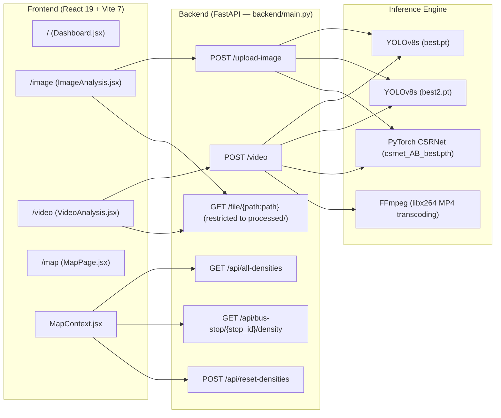

# Architecture & API Contract Specification

## 1. High-Level Architecture



---

## 2. Backend API Specification (`backend/main.py`)

### 2.1 `POST /upload-image`
Analyzes a single uploaded image using the selected model, updates the in-memory stop density for `stop`, and writes an annotated image to `backend/processed/`.

- **Content-Type:** `multipart/form-data`
- **Form Fields:**
  - `file` (`UploadFile`, required): Input image file (`.jpg`, `.png`, etc.).
  - `stop` (`str`, required): Transit stop identifier (e.g. `mecidiyekoy`, `taksim`, `zincirlikuyu`).
  - `model_name` (`str`, optional, default `"best"`): One of `"best"`, `"best2"`, or `"csrnet_ab"`.
- **Response (`200 OK`):**
  ```json
  {
    "count": 42,
    "lat": 41.069895,
    "lng": 28.987237,
    "processed_image": "/file/processed/annotated_<uuid>.jpg",
    "model_used": "best"
  }
  ```

### 2.2 `POST /video`
Analyzes an uploaded video file, generates an annotated H.264 MP4 video in `backend/processed/`, updates the stop density with the average frame count, and returns per-frame time-series counts.

- **Content-Type:** `multipart/form-data`
- **Form Fields:**
  - `video` (`UploadFile`, required): Input video file (`.mp4`, `.avi`, etc.).
  - `stop` (`str`, required): Transit stop identifier.
  - `model_name` (`str`, optional, default `"best"`): `"best"`, `"best2"`, or `"csrnet_ab"`.
- **Inference Behavior:**
  - **YOLOv8 (`best`, `best2`):** Runs person detection (`cls == 0`) on every frame; `avg_people = round(total_count / max(frame_number, 1))`.
  - **CSRNet (`csrnet_ab`):** Evaluates every 5th frame (`CSRNET_VIDEO_FRAME_SKIP = 5`) using $384 \times 384$ patch inference (`stride = 192`) and Gaussian blending; `avg_people = round(total_count / max(processed_frames, 1))`.
  - **Transcoding:** Writes intermediate frames to `processed/tmp_<uuid>.avi` (`XVID`), invokes FFmpeg (`-c:v libx264 -pix_fmt yuv420p -movflags +faststart`) to produce `processed/processed_<uuid>.mp4`, and removes the temporary AVI.
- **Response (`200 OK`):**
  ```json
  {
    "total_count": 240,
    "avg_people": 40,
    "frame_results": [
      {"frame": 0, "count": 39},
      {"frame": 1, "count": 41}
    ],
    "lat": 41.036948,
    "lng": 28.985078,
    "processed_video": "/file/processed/processed_<uuid>.mp4",
    "fps": 25.0,
    "model_used": "best"
  }
  ```

### 2.3 `GET /api/bus-stop/{stop_id}/density`
Returns the latest person count and qualitative Turkish density label (`Düşük` for `< 5`, `Orta` for `< 20`, `Yüksek` for `>= 20`) for a specific transit stop.

- **Response (`200 OK`):**
  ```json
  {
    "stop_id": "taksim",
    "people": 40,
    "density": "Yüksek"
  }
  ```

### 2.4 `GET /api/all-densities`
Returns coordinates and current person counts for all 15 registered transit stops. Polled every 10 seconds by `MapContext.jsx` to update the deck.gl heatmap.

### 2.5 `POST /api/reset-densities`
Resets all stop counts in `STOP_DENSITY` to `0.0`. Called on initial frontend mount.

### 2.6 `GET /file/{path:path}`
Serves generated media files strictly from `backend/processed/`.
- Only paths starting with `processed/<filename>` and matching `{.jpg, .jpeg, .png, .mp4}` are permitted.
- Any attempt to traverse directories (`..`), pass nested subdirectories, or access files outside `backend/processed/` returns `403 Forbidden`.
- Missing files inside `backend/processed/` return `404 Not Found`.
