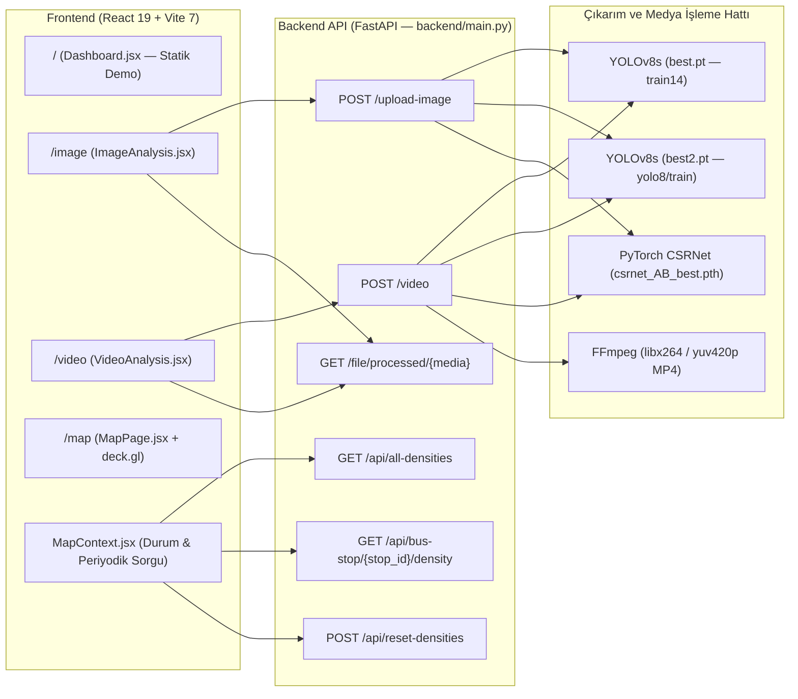
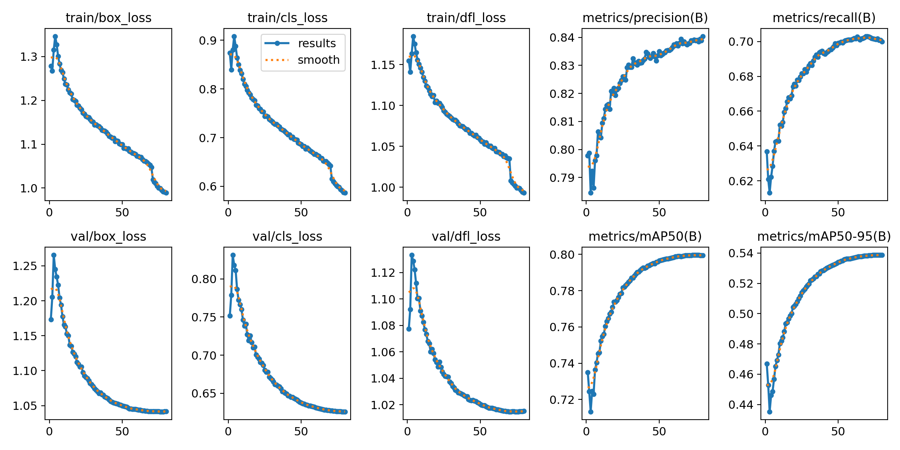
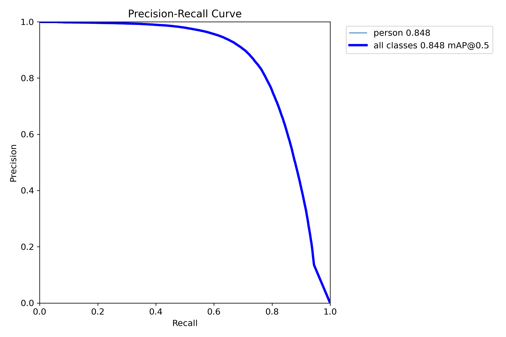
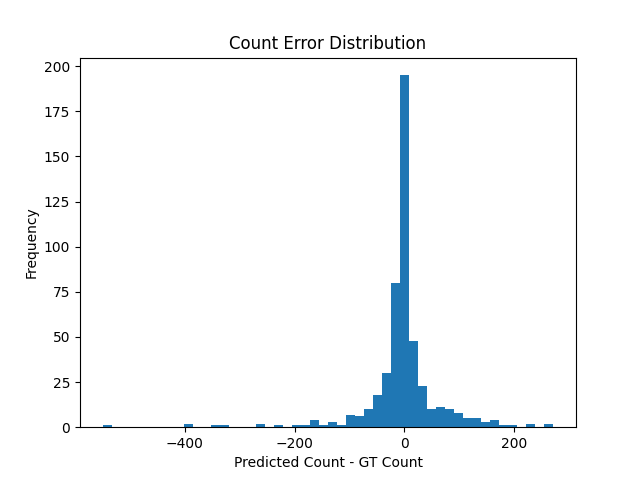

# Hibrit Kalabalık Sayımı ve Toplu Taşıma Yoğunluk Analizi (YOLOv8 + CSRNet)


İstanbul'daki 15 merkezi toplu taşıma durağında kalabalık sayımı, yoğunluk tahmini ve coğrafi harita görselleştirmesi için geliştirilmiş bilgisayar mühendisliği **Bitirme Projesi**.

Toplu taşıma istasyonlarında gözlemlenen farklı kalabalık seviyelerini doğru analiz edebilmek amacıyla sistem iki tamamlayıcı derin öğrenme yaklaşımını **FastAPI** arka ucu ve **React + Vite + Tailwind CSS + Chart.js + Google Maps / deck.gl** web arayüzünde birleştirir:
- **Düşük ve Orta Yoğunluklu Sahneler (`YOLOv8s`):** Bireylerin ayırt edilebildiği sahnelerde sınır kutusu (*bounding-box*) tabanlı insan tespiti (`best` ve `best2`).
- **Yüksek Yoğunluklu / Sıkışık Kalabalıklar (`CSRNet`):** Kişilerin birbirini örttüğü yoğun kalabalıklarda $384 \times 384$ örtüşen Gauss yama çıkarımı (*patch inference*) kullanan genişletilmiş evrişimli yoğunluk haritası regresyonu (`csrnet_ab`).

> **Dil / Language:** [Türkçe (`docs/README.tr.md`)](README.tr.md) | [English (`../README.md`)](../README.md)

---

## Sistem Mimarisi



---

## Teknoloji Yığını

| Katman | Kullanılan Teknolojiler |
|---|---|
| **Backend ve API** | Python 3.12.7, FastAPI 0.121.3, Uvicorn 0.38.0, python-multipart |
| **Derin Öğrenme ve Görüntü İşleme** | PyTorch 2.5.1 + Torchvision 0.20.1 (CUDA 12.1), Ultralytics YOLOv8 (`8.3.237`), OpenCV (`4.12.0.88`), Pillow, NumPy, SciPy, h5py |
| **Video Dönüştürme** | FFmpeg (`libx264`, `yuv420p`, `-movflags +faststart`) |
| **Frontend Arayüzü** | React 19.2, React Router 7, Vite 7.2, Tailwind CSS 3.4, Lucide İkonları |
| **Grafik ve Harita** | Chart.js 4.5 + `react-chartjs-2`, Google Maps JavaScript API (`AdvancedMarkerElement`, `InfoWindow`), `deck.gl` (`@deck.gl/GoogleMapsOverlay`, `HeatmapLayer`) |

---

## Proje Klasör Yapısı

```text
hybrid-crowd-counting/
├── backend/                        # FastAPI uygulama sunucusu
│   ├── main.py                     # Ana API (YOLOv8 + CSRNet çıkarımı ve durak yoğunluk uç noktaları)
│   ├── models/
│   │   ├── csrnet.py               # PyTorch CSRNet mimarisi (VGG16 + dilated conv)
│   │   └── __init__.py             # (best.pt, best2.pt, csrnet_AB_best.pth buraya konur; Git dışı)
│   ├── tests/
│   │   └── test_security_and_api.py# Güvenlik (path traversal, CORS, 503) ve model entegrasyon testleri
│   ├── legacy/                     # Eski Node.js/Express prototipi (arşiv amaçlı)
│   ├── uploads/                    # Geçici yükleme klasörü (Git dışı)
│   ├── processed/                  # İşlenmiş görsel ve video çıktı klasörü (Git dışı)
│   ├── requirements.txt            # Doğrulanmış Python bağımlılıkları
│   └── requirements-lock.txt       # Python 3.12.7 + CUDA 12.1 tam sürüm kilidi
├── frontend/                       # React 19 + Vite 7 + Tailwind CSS + Chart.js + Google Maps arayüzü
│   ├── src/
│   │   ├── config.js               # Ortam değişkeni tabanlı API URL ve Google Maps ayarları
│   │   ├── context/MapContext.jsx  # Durak işaretçileri (marker) ve ısı haritası (heatmap) yönetimi
│   │   ├── data/stops.js           # 15 İstanbul toplu taşıma durağının koordinatları
│   │   ├── components/             # Navbar (karanlık mod destekli) ve Sidebar
│   │   └── pages/                  # Dashboard, ImageAnalysis, VideoAnalysis, MapPage
│   └── public/stops/               # Durak bilgi penceresi görselleri (Git dışı)
├── research/                       # Makine öğrenmesi eğitim, değerlendirme ve veri ön işleme kodları
│   ├── training/                   # CSRNet (ShanghaiTech A+B, UCF-QNRF) ve YOLO eğitim betikleri
│   ├── evaluation/                 # Değerlendirme betikleri, eğitim grafikleri ve sonuç tabloları
│   ├── preprocessing/              # Veri seti dönüştürme betikleri (CrowdHuman, MOT20, ShanghaiTech)
│   ├── configs/                    # Veri seti YAML dosyaları ve kaynak bilgileri
│   └── legacy/                     # İlk aşama Streamlit / RandomForest denemeleri
├── examples/                       # Telif hakkı doğrulanmış örnek görsel/videolar için klasör
├── docs/                           # Teknik dokümantasyon
│   ├── README.tr.md                # Türkçe ana doküman
│   ├── ARCHITECTURE.md             # Sistem mimarisi ve API sözleşmeleri
│   ├── MODELS_AND_EXPERIMENTS.md   # Eğitilen modeller, metrikler ve büyük dosya envanteri
│   └── SECURITY_AND_LICENSING.md   # Güvenlik iyileştirmeleri, API anahtarı ve lisans incelemesi
├── LICENSE                         # GNU Affero General Public License v3.0 (özgün proje kodu için)
├── THIRD_PARTY_NOTICES.md          # Üçüncü taraf bildirimleri, veri seti atıfları ve akademik kaynaklar
├── .env.example                    # Ortam değişkeni şablonu
└── .gitignore                      # Model ağırlıkları, veri setleri ve gizli dosyalar için kurallar
```

---

## Modeller, Mimariler ve Doğrulanmış Değerlendirme Sonuçları

> [!NOTE]
> **Değerlendirme Metrikleri Hakkında Metodolojik Not:**
> Nesne tespiti modelleri (**YOLOv8**) ve yoğunluk haritası regresyon modelleri (**CSRNet**) farklı veri setleri üzerinde farklı amaç fonksiyonlarını optimize eder:
> - **YOLOv8s** modelleri sınır kutusu doğruluk metrikleri (**Precision**, **Recall**, **mAP@50**, **mAP@50-95**) ile değerlendirilir.
> - **CSRNet** modeli görüntü genelindeki kişi sayısı tahmin hataları (**MAE** — Ortalama Mutlak Hata ve **RMSE** — Kök Ortalama Kare Hata) ile değerlendirilir.
>
> Bu iki metrik grubu farklı görevleri ölçtüğünden birbirleriyle **doğrudan kıyaslanabilir tek bir ölçek olarak yorumlanmamalıdır**.

### 1. YOLOv8s İnsan Tespiti Modelleri (`best` ve `best2`)

| Çalışma Zamanı Anahtarı | Eğitim Koşusu | Veri Seti ve Bölünme | Epoch | Precision | Recall | mAP@50 | mAP@50-95 |
|---|---|---|---:|---:|---:|---:|---:|
| **`best`** (`best.pt`) | [`yolov8s_reid_train14__APP_best`](../research/evaluation/yolo/runs/yolov8s_reid_train14__APP_best/results.csv) | `reid.v1i.yolov8` (`valid`) | 50 | `0.8180` | `0.6929` | **`0.7796`** | `0.4832` |
| **`best2`** (`best2.pt`) | [`yolov8s_yolo8_train__APP_best2`](../research/evaluation/yolo/runs/yolov8s_yolo8_train__APP_best2/results.csv) | `yolo8/data.yaml` (`valid`) | 80 | `0.8588` | `0.8077` | **`0.8736`** | `0.6251` |

#### Eğitim ve Doğrulama Grafikleri (YOLOv8s)
| `best2` (`yolo8/train`) — 80 Epoch Eğitim Özeti | `best` (`train14`) — Precision-Recall Eğrisi |
|---|---|
|  |  |

---

### 2. PyTorch CSRNet Yoğunluk Regresyon Modeli (`csrnet_ab`)

- **Mimari ([`backend/models/csrnet.py`](../backend/models/csrnet.py)):** ImageNet ön eğitimli `VGG16` ilk 23 katmanı (`features[:23]`, çıkış adımı $8$) + 6 adet genişletilmiş evrişim (*dilated convolution*, `dilation=2`) katmanı ve $1 \times 1$ yoğunluk çıkış katmanı.
- **Eğitim ve Çıkarım ([`research/training/csrnet_shanghaitech/train.py`](../research/training/csrnet_shanghaitech/train.py)):** ShanghaiTech Part A + Part B birleşik veri seti üzerinde 120 epoch boyunca toplam koruyucu yeniden boyutlandırma, arka plan bastırma kaybı ve sahne duyarlı ağırlıklandırma ile eğitilmiştir. Çalışma zamanında $384 \times 384$ örtüşen yamalar ($\text{stride}=192$) ve 2B Gauss ağırlıklandırması ile birleştirilerek `COLORMAP_JET` ısı haritası üretilir.

| Çalışma Zamanı Anahtarı | Değerlendirme Veri Seti | MAE | RMSE | Eksik Sayım Oranı | Fazla Sayım Oranı | $\pm \%10$ Hata İçi Oran |
|---|---|---:|---:|---:|---:|---:|
| **`csrnet_ab`** (`csrnet_AB_best.pth`) | ShanghaiTech Part A + Part B Birleşik Test Kümesi ([`summary.txt`](../research/evaluation/csrnet_shanghaitech/results/summary.txt)) | **`35.84`** | **`69.92`** | `0.540` | `0.460` | **`%51.4`** (`0.514`) |

#### CSRNet Sayım Hatası Dağılımı


Detaylı model geçmişi için [`docs/MODELS_AND_EXPERIMENTS.md`](MODELS_AND_EXPERIMENTS.md) dosyasına bakabilirsiniz.

---

## Uygulama Özellikleri

1. **Fotoğraf Analizi (`/image` -> `POST /upload-image`):**
   - Seçilen durağa ait fotoğrafı `best` (YOLOv8s), `best2` (YOLOv8s) veya `csrnet_ab` (CSRNet) modelleriyle analiz eder; tespit edilen kişi sayısını, işlenmiş görseli ve harita üzerindeki durak işaretçisini günceller.
2. **Video Analizi ve Grafik Senkronizasyonu (`/video` -> `POST /video`):**
   - Yüklenen videoları YOLOv8 ile kare kare (veya CSRNet ile her 5 karede bir) işler ve FFmpeg (`libx264`, `yuv420p`, `+faststart`) ile tarayıcı uyumlu MP4 formatına dönüştürür.
   - Video oynatılırken o anki karedeki kişi sayısını **Chart.js** çizgi grafiği üzerinde eşzamanlı olarak vurgular.
3. **Durak Haritası ve Isı Haritası (`/map`):**
   - İstanbul'daki 15 merkezi toplu taşıma noktasını Google Maps `AdvancedMarkerElement` ve açılıp kapatılabilir **deck.gl `HeatmapLayer`** ile görselleştirir; her 10 saniyede bir `/api/all-densities` uç noktasından güncel yoğunlukları çeker.
4. **Gösterge Paneli (`/`, Statik Demo Görünümü):**
   - `frontend/src/pages/Dashboard.jsx` sayfası örnek bir Chart.js sütun grafiği sunar (şu anda canlı veritabanı yerine sabit gösterim değerleri kullanmaktadır; bkz. [Bilinen Sınırlamalar](#bilinen-sınırlamalar)).

---

## Kurulum ve Çalıştırma

### 1. Model Ağırlıklarının Yerleştirilmesi (Seçenek C — Yalnızca Yerel)

Model ağırlıkları (`~105 MB`) dosya boyutu ve veri seti lisans sınırları nedeniyle Git deposuna dahil edilmemiştir (bkz. [`THIRD_PARTY_NOTICES.md`](../THIRD_PARTY_NOTICES.md)). Yerel çıkarım için aşağıdaki üç dosyayı `backend/models/` dizinine yerleştirin:

- `backend/models/best.pt` (`22.5 MB`, YOLOv8s — `train14`)
- `backend/models/best2.pt` (`22.5 MB`, YOLOv8s — `yolo8/train`)
- `backend/models/csrnet_AB_best.pth` (`65.1 MB`, PyTorch CSRNet — `ShanghaiTech A+B`)

> **Temiz Klon (Clean Clone) Davranışı:**
> - Model ağırlıkları henüz `backend/models/` klasörüne yerleştirilmeden sunucu başlatılırsa, FastAPI uygulaması sorunsuz ayağa kalkar; analiz uç noktaları (`POST /upload-image`, `POST /video`) çağrıldığında ağırlık dosyasının eksik olduğunu belirten anlaşılır bir `503 Service Unavailable` yanıtı döner.
> - `frontend/public/stops/*.jpg` altındaki durak fotoğrafları telif/yeniden dağıtım izinleri doğrulanmadığı için Git deposuna dahil edilmemiştir. Temiz bir klonda harita işaretçisine tıklandığında eksik görsel alanı DOM `error` dinleyicisi ile otomatik olarak gizlenir ve durak adı, yoğunluk etiketi ile kişi sayısı sorunsuz görüntülenir.

### 2. Backend (FastAPI) Kurulumu

```powershell
cd backend
python -m venv .venv
.\.venv\Scripts\activate

# NVIDIA GPU (CUDA 12.1) kullanıyorsanız önce PyTorch kurun:
pip install torch==2.5.1 torchvision==0.20.1 --index-url https://download.pytorch.org/whl/cu121

# Diğer bağımlılıkları yükleyin:
pip install -r requirements.txt

# Güvenlik ve API testlerini çalıştırın:
python -B tests/test_security_and_api.py

# Sunucuyu başlatın:
uvicorn main:app --host 127.0.0.1 --port 8000
```

- **API Dokümantasyonu:** Sunucu çalışırken `http://127.0.0.1:8000/docs` adresinden etkileşimli OpenAPI arayüzüne ve [`docs/ARCHITECTURE.md`](ARCHITECTURE.md) dosyasından uç nokta sözleşmelerine ulaşabilirsiniz.

### 3. Frontend (React + Vite) Kurulumu

```powershell
cd frontend
cp .env.example .env
# .env dosyasındaki VITE_GOOGLE_MAPS_API_KEY değerini kendi kısıtlanmış anahtarınızla güncelleyin

npm ci
npm run dev
```

Tarayıcıda `http://localhost:5173` adresini açın.

---

## Güvenlik Notları

- **Frontend Ortam Değişkenleri Gizli Değildir:** Vite projelerinde `VITE_` önekiyle tanımlanan değişkenler derleme sırasında doğrudan istemci tarafı JavaScript paketine gömülür. `.env` kullanımı anahtarın Git geçmişine girmesini engeller ancak tarayıcıda görünmesini engellemez. Bu nedenle Google Cloud Console üzerinden API anahtarınıza **HTTP yönlendiren (referrer) kısıtlaması** ve **yalnızca Maps JavaScript API yetkisi** tanımlamanız zorunludur. Detaylı adımlar için [`docs/SECURITY_AND_LICENSING.md`](SECURITY_AND_LICENSING.md) dosyasına bakın.
- **Güvenli Dosya Sunumu:** `/file/{path}` uç noktası yalnızca `backend/processed/` altındaki `.jpg`, `.jpeg`, `.png` ve `.mp4` dosyalarını sunar; dizin geçişi (`..`) ve kaynak kod erişim girişimlerini HTTP `403` ile engeller.
- **CORS Kısıtlaması:** Tüm kaynaklara açık (`*`) CORS ayarı kaldırılmış, `CORS_ALLOWED_ORIGINS` ile yalnızca izin verilen adreslere sınırlandırılmıştır.

---

## Bilinen Sınırlamalar

1. **Bellek İçi Durak Yoğunlukları:** Durak kişi sayıları (`STOP_DENSITY`) sunucu belleğinde tutulur; sunucu yeniden başlatıldığında veya `POST /api/reset-densities` çağrıldığında sıfırlanır.
2. **Statik Gösterge Paneli Grafiği:** `frontend/src/pages/Dashboard.jsx` sayfasındaki sütun grafiği şu anda canlı veritabanı verisi yerine sabit örnek değerler göstermektedir.
3. **CSRNet Video Kare Atlama Adımı:** İşlem süresini makul tutmak adına CSRNet video analizinde her 5 karede bir (`CSRNET_VIDEO_FRAME_SKIP = 5`) çıkarım yapılır.
4. **Yardımcı Deney Koşusu Notu:** `train15` ve `train16` yardımcı deneyleri `data_MOT20_YOLO.yaml` içindeki `val: images/train` ayarı nedeniyle eğitim kümesi üzerinde değerlendirilmiştir; bu koşulara ait skorlar genelleme başarısı olarak kullanılmamalıdır (bkz. [`docs/MODELS_AND_EXPERIMENTS.md`](MODELS_AND_EXPERIMENTS.md)).

---

## Lisans, Üçüncü Taraf Bildirimleri ve Akademik Atıflar

- **Özgün Proje Kodu:** **GNU Affero General Public License v3.0 (AGPL-3.0)** kapsamında lisanslanmıştır — bkz. [`../LICENSE`](../LICENSE).
- **Üçüncü Taraf Bileşenler, Uyarlanan Araştırma Kodları ve Veri Seti Atıfları:** Tüm detaylar ve BibTeX kaynakları [`../THIRD_PARTY_NOTICES.md`](../THIRD_PARTY_NOTICES.md) ve [`docs/SECURITY_AND_LICENSING.md`](SECURITY_AND_LICENSING.md) dosyalarında belgelenmiştir.
